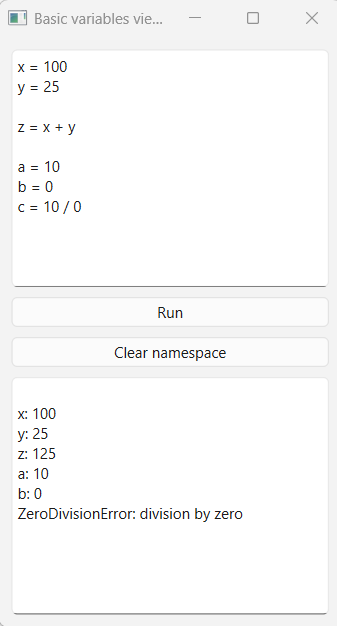
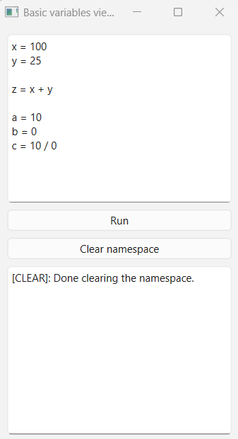
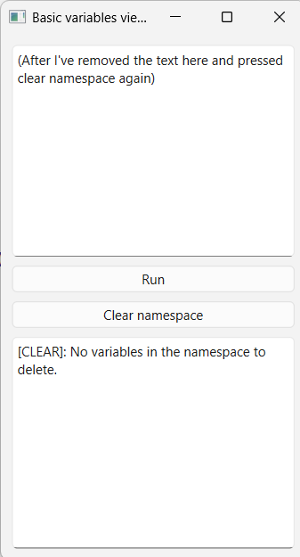
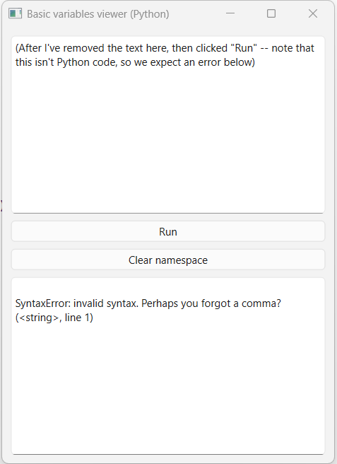

# Basic Python Variables Viewer

## Overview

    This is a simple script that opens a user interface.
    The upper portion is where a user can write their own python code.
    The middle portion contains the "run" button. Clicking this will execute what's currently in the upper portion.
    The middle portion also contains the "clear namespace" button. Clicking this will clear the variables currently present in the session namespace, if present.
    The lower portion displays the current variables in the session's namespace, after clicking "Run"

## Features
    - Execute Python code
    - Inspect variables
    - Maintain variables during the session.
    
## Screenshot

    
## Warning
    Note that the application can run arbitrary Python code (whatever's in the top window)
    and so you should only run trusted input.

## Limitations
    - Not a sandbox
    - Long running code may freeze the UI.
    - NOTE: This program does not show the output of print(). This is only for viewing variables in a namespace.
    
## Installation
    - Clone repository
    - Run: python -m pip install -r requirements.txt
    
## Launching:
    - Run: python main.py

